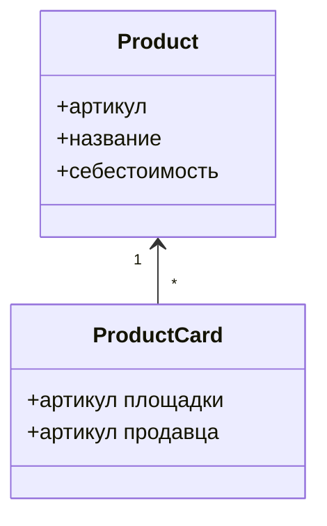

# Предметная область и сущности

Учёт экономики магазина продавца на маркетплейсах в РФ.

## Объект исследования

Объект исследования — торговая деятельность маркетплейсов в РФ. 

Предмет исследования - технологическое взаимодействие селлера и маркетплейсов необходимое для финансового и управленческого учета 

Сущности объекта:

1. **Товар** — артикул справочника, общий для трёх площадок.
2. **Карточка** — представление товара в кабинете.
3. **Себестоимость** — цена товара на дату. Источник значения — продавец. - не выделять в отдельную сущность - это св-во товара ???

## Цель проекта ???

Дать продавцу задать вопрос о прибыли артикула через внешнего агента и получить ответ по формулам onctrl, в границах своего пространства, без изменения данных.

## Задачи ???

1. Хранить себестоимость продавца отдельно от операций площадки.
2. Считать прибыль метриками: общая операция расчёта, отдельная формула у каждого показателя.
3. Выпускать токен чтения на пространство.
4. Принимать вопрос с периодом и артикулом и возвращать готовые метрики.

## Классы и диаграммы

В фрагменте две сущности и два класса. `Product` — товар, себестоимость хранится его свойством. `ProductCard` — карточка этого товара на площадке. Карточка ссылается на товар.

