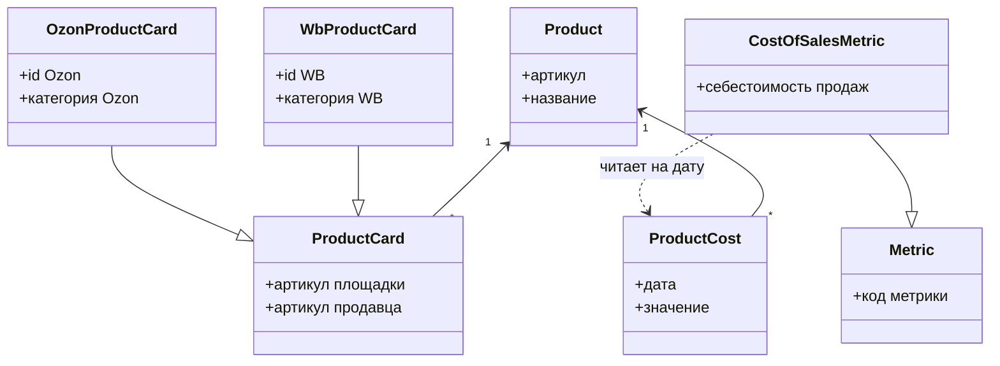

# Предметная область и сущности

Учёт экономики магазина продавца на маркетплейсах в РФ.

## Объект исследования

Объект исследования — торговая деятельность маркетплейсов в РФ. 

Предмет исследования - технологическое взаимодействие селлера и маркетплейсов необходимое для финансового и управленческого учета 

## Прецеденты

Прецедент — сценарий работы продавца с системой в этой предметной области.

1. **Создать товар.** Продавец заводит артикул и название.
2. **Привязать карточку к товару.** Продавец имеет возможность привязать карточку МП к товару. Может отменить текущую привязку и создать новую.
3. Существует непрерывная история себестоимости по датам на товар.
4. **Задать себестоимость на дату.** При первичном наполнении и дальнейшем изменении себестоимости продавец ее заводит/изменяет.
5. Продавец может изменить цену товара. Имеет возможность выставить единую цену для всех МП или индивидуальную под площадку.
6. Продавец формирует несколько отчетов. Первый отчет включает показатели заказов за заданный период. Первый отчет включает показатели возвратов за заданный период.

## Сущности объекта:

1. **Товар** (`Product`) — артикул и название справочника, общий для площадок.
2. **Карточка** (`ProductCard`) — представление товара в кабинете площадки; ссылается на товар.
3. **Карточка WB / Ozon** — наследники карточки: id и категория площадки.
4. **Себестоимость** (`ProductCost`) — значение на дату; ссылается на товар.
5. **Отчеты** (`Report`) — код показателя отчёта.

## Классы и диаграммы

`Product` — артикул и название. `ProductCard` — общая карточка; `WbProductCard` и `OzonProductCard` наследуют её. `ProductCost` хранит себестоимость на дату и ссылается на товар. `Metric` — код показателя; `CostOfSalesMetric` наследует `Metric` и читает `ProductCost`.

