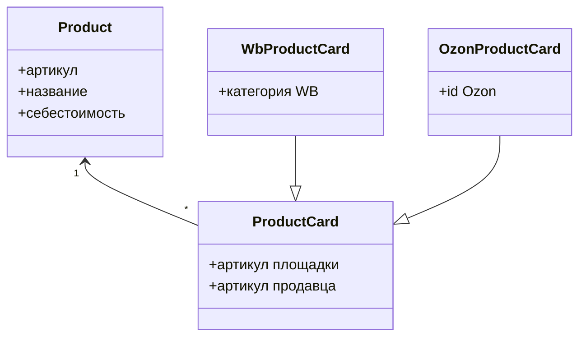

# Предметная область и сущности

Учёт экономики магазина продавца на маркетплейсах в РФ.

## Объект исследования

Объект исследования — торговая деятельность маркетплейсов в РФ. 

Предмет исследования - технологическое взаимодействие селлера и маркетплейсов необходимое для финансового и управленческого учета 

Сущности объекта:

1. **Товар** — артикул справочника, общий для трёх площадок. Себестоимость — свойство товара, отдельной сущностью не выделяется.
2. **Карточка** — представление товара в кабинете площадки.

## Прецеденты

Прецедент — сценарий работы продавца с системой в этой предметной области.

1. **Создать товар.** Продавец заводит артикул справочника: название и себестоимость.
2. **Создать карточку площадки.** Продавец заводит карточку Wildberries или Ozon со своими артикулами площадки.
3. **Привязать карточку к товару.** Карточка площадки связывается с одним товаром справочника. Один товар может иметь несколько карточек.
4. **Показать карточку с данными площадки.** Система выводит общие поля карточки и поля конкретной площадки: у Wildberries — категория, у Ozon — внутренний id.

## Классы и диаграммы

`Product` — товар, себестоимость хранится его свойством. `ProductCard` — общая карточка на площадке. `WbProductCard` и `OzonProductCard` наследуют `ProductCard`. Карточка ссылается на товар.

