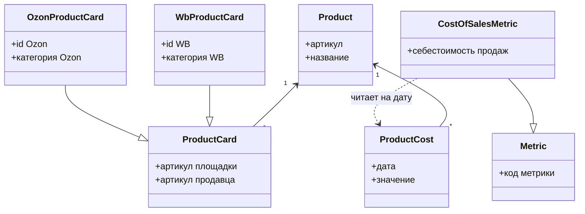

# Предметная область и сущности

Учёт экономики магазина продавца на маркетплейсах в РФ.

## Объект исследования

Объект исследования — торговая деятельность маркетплейсов в РФ. 

Предмет исследования - технологическое взаимодействие селлера и маркетплейсов необходимое для финансового и управленческого учета 

Сущности объекта:

1. **Товар** (`Product`) — артикул и название справочника, общий для площадок.
2. **Карточка** (`ProductCard`) — представление товара в кабинете площадки; ссылается на товар.
3. **Карточка WB / Ozon** — наследники карточки: id и категория площадки.
4. **Себестоимость** (`ProductCost`) — значение на дату; ссылается на товар.
5. **Метрика** (`Metric`) — код показателя отчёта.
6. **Себестоимость продаж** (`CostOfSalesMetric`) — наследник метрики; читает `ProductCost` по товару и дате.

## Прецеденты

Прецедент — сценарий работы продавца с системой в этой предметной области.

1. **Создать товар.** Продавец заводит артикул и название.
2. **Создать карточку площадки.** Карточка Wildberries или Ozon со своими артикулами, id и категорией.
3. **Привязать карточку к товару.** Один товар — несколько карточек.
4. **Задать себестоимость на дату.** Для товара создаётся запись `ProductCost`.
5. **Показать товар и карточки.** Общие поля карточки и поля площадки.
6. **Посчитать себестоимость продаж.** `CostOfSalesMetric` читает `ProductCost` на дату.

## Классы и диаграммы

`Product` — артикул и название. `ProductCard` — общая карточка; `WbProductCard` и `OzonProductCard` наследуют её. `ProductCost` хранит себестоимость на дату и ссылается на товар. `Metric` — код показателя; `CostOfSalesMetric` наследует `Metric` и читает `ProductCost`.

